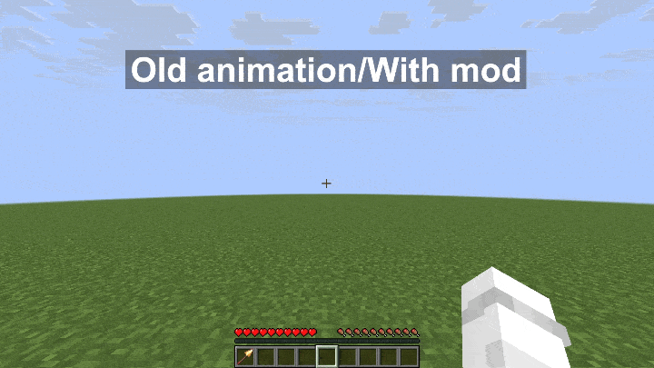

# Stab Animation Restorer

Minecraft version 26.3 snapshot 7 came out with changes to the swing animation handling,
which resulted into the spear lunge/jab attack animation to continue playing after the held item changes to a non-spear item.

I didn't like how it looked, so I brought back the old animation (1.21.11 to 26.3 snapshot 6). This isn't a bug, though it has been reported: [MC-310695](https://bugs.mojang.com/browse/MC/issues/MC-310695).